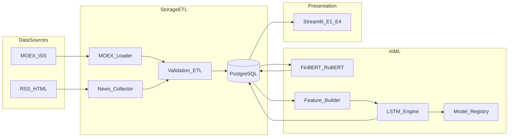

# План MVP: инвестиционная аналитическая AI-платформа (СРО2)

Документ уже фиксирует границы прототипа. **MVP = то, что входит в СРО2 (таблица 6)**: сбор данных → БД → тональность → LSTM → дашборд Э1–Э4. **Не делаем в MVP**: риск/портфель (ФТ-4), walk-forward и торговая стратегия (полный ФТ-5), полные дисклеймеры НФТ-5.

Репозиторий сейчас пустой (только docx) — старт с нуля.

## Цель MVP

Проверить гипотезу: дневной индекс тональности новостей улучшает прогноз направления цены на t+1 для 5–8 ликвидных акций MOEX, и показать это в интерактивном дашборде.

Тикеры (зафиксировать в `config/tickers.yaml`): SBER, GAZP, LKOH, ROSN, GMKN, NVTK, TATN, PLZL.

## Архитектура

Стек: Python, PyTorch, Transformers, pandas, scikit-learn, PostgreSQL/SQLAlchemy, Streamlit, Plotly, feedparser, BeautifulSoup, APScheduler.

## Структура репозитория

- `config/` — tickers.yaml, rss_sources.yaml, settings (.env)
- `src/etl/` — moex_loader, news_collector, validate
- `src/db/` — models, migrations, session
- `src/sentiment/` — lang detect, infer, aggregate
- `src/forecast/` — features, lstm, train, predict, baselines
- `src/scheduler/` — APScheduler jobs
- `src/dashboard/` — Streamlit multipage Э1–Э4
- `models/` — Model Registry (веса, config.json, metrics)
- `scripts/` — CLI: load, score, train, predict
- `docker-compose.yml`, `requirements.txt`, `README.md`

## Фазы реализации

### Фаза 0. Каркас (1–2 дня)
- Git, venv, зависимости, `.env.example`
- Docker Compose с PostgreSQL
- Конфиги: тикеры + псевдонимы, RSS, timezone Europe/Moscow, cutoff 19:00
- Схема БД по таблице 2 документа: candles, news, sentiment_scores, forecasts + view v_daily_sentiment
- Миграции SQLAlchemy/Alembic с PK/FK/CHECK как в СРО2

### Фаза 1. ETL (3–5 дней)
- MOEX Loader: ISS TQBR candles, interval=24, пагинация start, upsert по (ticker, trade_date)
- News Collector: feedparser (+ ETag), BeautifulSoup при необходимости; дедуп url/content_hash; привязка тикера по словарю псевдонимов
- Валидация партий, журнал ошибок ETL
- CLI: load_candles, load_news
- Готово когда: история 2–3 года по тикерам + новости в БД

### Фаза 2. Sentiment (3–4 дня)
- Чекпоинты: ProsusAI/finbert (en), blanchefort/rubert-base-cased-sentiment (ru)
- Пайплайн: lang → clean → tokenize (Lmax=128) → score = p_pos − p_neg → sentiment_scores
- Агрегация v_daily_sentiment по формулам (2.1)–(2.3)
- CLI: score_sentiment
- Заложить формат labeled_news.csv и sentiment_metrics.json (разметка ≥400 новостей — для СРО3)

### Фаза 3. LSTM + baselines (5–7 дней)
- Признаки: pt, vt, rt (+ Sk,t); окно N=30; MinMaxScaler только по train; split 70/15/15 хронологически
- LSTM: L=2, H=64, dropout=0.2, Adam, MSE, early stop, seed=42
- Две конфигурации: use_sentiment False (F=3) и True (F=4); naive baseline
- Model Registry + запись forecasts
- Метрики: MAE, RMSE, directional accuracy, RMSE_rel vs naive
- CLI: train_lstm, predict

### Фаза 4. Streamlit UI Э1–Э4 (4–6 дней)
Опора на макет Figma из документа и сценарии С1–С6.
- Э1: карточки, таблица тикеров, последние новости
- Э2: свечи Plotly + прогноз, карточки, топ новостей
- Э3: фильтры, распределение/динамика тональности, карточки со ссылками
- Э4: MAE/RMSE/DA/RMSE_rel, факт vs прогноз, sentiment_metrics.json
- Состояния: loading / empty / stale / DB error / model not trained
- UI только читает PostgreSQL; st.cache_data

### Фаза 5. Планировщик и склейка (2–3 дня)
- APScheduler (МСК): свечи 19:30 → новости каждые 30 мин → sentiment → прогноз 20:00
- README, smoke-тесты (OHLC, дедуп, split без look-ahead)
- Короткая строка-дисклеймер в сайдбаре

## Вне MVP (после)

- VaR, просадка, портфель (ФТ-4)
- Walk-forward + торговая стратегия (ФТ-5)
- XGBoost/Prophet в UI
- Auth/HTTPS
- Макропоказатели

## Роли

- Тимлид/аналитик (Илья): тикеры, RSS, разметка, приёмка, сравнение метрик
- Разработчик ИИ (Анастасия): Sentiment + LSTM + Registry
- Разработчик ПО (Асель): БД/ETL, Streamlit, scheduler, Docker

## Критерии приёмки

1. Свечи и новости по всем тикерам в БД
2. Тональность и дневной индекс считаются
3. Прогнозы F=3 и F=4 + сравнение с naive
4. Дашборд Э1–Э4 без прямых вызовов MOEX/RSS
5. Воспроизводимость: seed=42, model_version, зафиксированные зависимости
6. Численный ответ на гипотезу (улучшил / не улучшил sentiment)

## Старт первой недели (вертикальный срез)

1. Docker Postgres + миграции + tickers.yaml
2. Загрузка истории SBER, затем остальные тикеры
3. 1–2 RSS → news → score на 50 новостях
4. Train LSTM на одном тикере (F=3) → forecasts
5. Черновой Э2 (график + прогноз), затем расширение на Э1/Э3/Э4 и все тикеры
